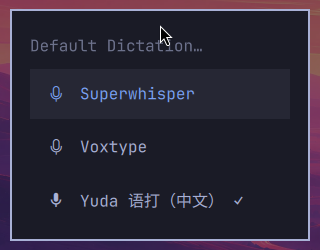
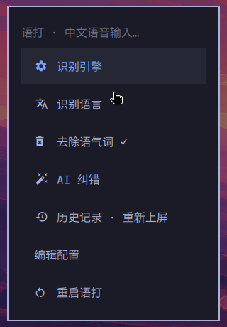

# 语打 Yuda

**Omarchy 上的中文语音输入：按住说话，松手上屏。** 对标豆包输入法的语音体验，以 Omarchy 原生听写后端的形式接入——快捷键、菜单、顶栏、主题都和 Omarchy 一体。

- 按住 **Right Alt** 或 **F9** 说话，松开即上屏；**Super + Ctrl + X** 切换录音。
- 屏幕底部的录音胶囊实时显示波形和识别中的文字，颜色跟随 Omarchy 主题。
- 云端用火山引擎豆包语音大模型（与豆包输入法同款）；断网或未配置时自动用本地 SenseVoice 模型，**不联网也能用**。

| 录音中（Tokyo Night） | 录音中（Catppuccin Latte） | 云端不可用，自动离线 |
|---|---|---|
|  |  |  |

| Setup › Defaults › Dictation | Setup › Yuda 语打 |
|---|---|
|  |  |

以上截图来自 Omarchy 官方 edge VM 镜像中的真实运行（`scripts/omarchy-e2e`）。

## 与豆包输入法对照

| 能力 | 语打 | 说明 |
|---|---|---|
| 按住说话、松手上屏 | ✓ | Omarchy 统一听写快捷键；按住少于 300 ms 视为误触 |
| 点按切换录音 | ✓ | Super + Ctrl + X，或点击顶栏麦克风 |
| 边说边出字 | ✓ | 离线：VAD 分句 + 尾段 0.4 s 刷新；云端：流式结果 |
| 自动标点、数字规整 | ✓ | 「下午五点」→「下午5点。」 |
| 中英混输 | ✓ | `Python`、`JSON` 等英文原样保留 |
| 粤语 / English / 日本語 / 한국어 | ✓ | Setup › Yuda 语打 › 识别语言 |
| 去口语化（嗯、呃） | ✓ | 只删不可能是正文的语气词，「额外」「好啊」不受影响 |
| 个人词库 | ✓ | `[text.replacements]`，例如 `"配森" = "Python"` |
| 热词 | ✓ | 云端引擎 `hotwords` |
| AI 纠错 | ✓ | 任意 OpenAI 兼容端点；只修同音字和误识别的术语，超时直接上屏原文 |
| 豆包大模型识别 | ◐ | 已按官方协议实现并通过本地协议测试；尚未用真实密钥联调 |
| 离线识别 | ✓ | SenseVoice-Small int8，本机 CPU；松手到上屏实测 0.23–0.72 秒 |
| 识别历史、重新上屏 | ✓ | 只存本机，`yuda history`、菜单「历史记录 · 重新上屏」 |
| 终端里也能上屏 | ✓ | 与 Omarchy 的 Super+V 同一路径，终端自动用 Ctrl+Shift+V |
| 不污染剪贴板 | ✓ | 上屏后恢复原剪贴板；临时内容标记为敏感，不进剪贴板历史 |
| 语音改写指令（「把 A 改成 B」） | ✗ | 尚未支持 |

## 安装

需要 **Omarchy 4 的 edge 版本**（带可插拔听写后端；`omarchy-dictation-use` 命令存在即可）。稳定版 4.0.4 还没有这个接口，安装器会提示先更新。

从源码安装：

```bash
git clone https://github.com/DevEverything01/yuda.git
cd yuda
omarchy-pkg-add base-devel rust clang cmake alsa-lib pkgconf
make build
sudo make install PREFIX=/usr
omarchy-install-dictation-yuda
```

`packaging/PKGBUILD` 是 `yuda-git` 的 AUR 包定义（尚未发布到 AUR），也可以在 `packaging/` 目录里用 `makepkg -si` 安装。

`omarchy-install-dictation-yuda` 会：

1. 写入默认配置 `~/.config/yuda/config.toml`（权限 0600，已有配置不覆盖）；
2. 下载离线模型 SenseVoice-Small 与 Silero VAD（约 160 MB，sha256 校验）；
3. 询问是否填写火山引擎密钥（可跳过）；
4. 启用 `yuda.service`；
5. 安装录音浮层插件 `yuda.dictation` 并合并 Omarchy 菜单条目；
6. 把 Omarchy 默认听写后端切换为语打。

之后也可以在 Omarchy 菜单 **Setup › Defaults › Dictation** 里在 Superwhisper、Voxtype 和 **Yuda 语打** 之间切换。

## 使用

| 操作 | 效果 |
|---|---|
| 按住 Right Alt 或 F9 | 录音；松开后识别并上屏 |
| Super + Ctrl + X | 开始 / 结束录音 |
| 点击顶栏麦克风 | 同上 |
| Setup › Yuda 语打 › 历史记录 | 选一条重新上屏 |

在 Right Alt 是 AltGr 的键盘布局上，用 F9。

## 设置

Omarchy 菜单 **Setup › Yuda 语打**：

- **识别引擎**：自动（云端优先，2 秒连不上用离线）/ 云端 / 离线
- **识别语言**：中文（中英混输）/ English / 粤语 / 日本語 / 한국어
- **去除语气词**、**AI 纠错**：开关
- **编辑配置**：打开 `~/.config/yuda/config.toml`，所有选项都有中文注释（见 [examples/config.example.toml](examples/config.example.toml)）
- **重启语打**

命令行同样可用：`yuda config set engine offline`、`yuda config get language`。修改后 daemon 自动重新加载。

## 豆包云端识别（可选）

1. 在[火山引擎控制台](https://console.volcengine.com/speech/app)开通「豆包语音 · 大模型流式语音识别」，创建应用。
2. 旧版控制台：把 **APP ID** 填到 `cloud.app_key`，**Access Token** 填到 `cloud.access_key`；新版控制台只有一个 **API Key**：`app_key` 留空，`access_key` 填 API Key。
3. `resource_id` 默认 `volc.bigasr.sauc.duration`（小时版）；并发版改为 `volc.bigasr.sauc.concurrent`。

计费按识别时长，参考价约 ¥2.2/小时，以火山引擎官网为准。没有密钥时语打始终使用离线模型。

## 隐私

- 离线模式下音频只在本机内存中处理，不落盘。
- 云端模式把录音发送到火山引擎；AI 纠错把识别文本发送到你配置的端点。
- 识别历史只存本机 `~/.local/state/yuda/history.jsonl`（0600），可在配置中关闭。

## 故障排查

```bash
yuda doctor                         # 检查配置、模型、服务、Omarchy 集成
yuda status                         # 当前状态
journalctl --user -u yuda -f        # daemon 日志
```

- **没有反应**：确认 `omarchy default dictation` 输出 `yuda`，`systemctl --user status yuda` 在运行。
- **识别为空**：「没有识别到语音」说明麦克风没有声音，检查 PipeWire 默认输入设备。
- **某个应用收不到文字**：语打会把结果留在剪贴板并通知，按 Super+V 粘贴；个别游戏或 XWayland 程序不支持 Wayland 剪贴板同步。

卸载：`omarchy-remove-dictation-yuda`（Omarchy 菜单 Remove › Dictation › Yuda 语打）。

## 非 Omarchy 的 Hyprland

在配置里设置 `trigger.source = "evdev"`，语打会自己监听 `trigger.evdev_key`（默认右 Ctrl，需要 `sudo usermod -aG input $USER` 后重新登录），然后 `systemctl --user enable --now yuda`。此模式没有录音浮层。

## 开发

| 文档 | 内容 |
|---|---|
| [AGENTS.md](AGENTS.md) | 协作规范（人类与 AI Agent） |
| [PROMPT.md](PROMPT.md) | 产品规格 |
| [docs/architecture.md](docs/architecture.md) | 架构与模块 |
| [docs/ipc.md](docs/ipc.md) | daemon ↔ 插件 ↔ 适配器协议 |
| [docs/testing.md](docs/testing.md) | 测试分层与 Omarchy VM 端到端验收 |
| [docs/adr/](docs/adr/) | 架构决策记录 |

```bash
make check                          # fmt + clippy + 默认特性测试（任意平台）
cargo test --features daemon        # 全量（Linux）
scripts/omarchy-e2e                 # 在 Omarchy VM 中端到端验收（KVM 宿主机）
```

## 许可

[MIT](LICENSE)
